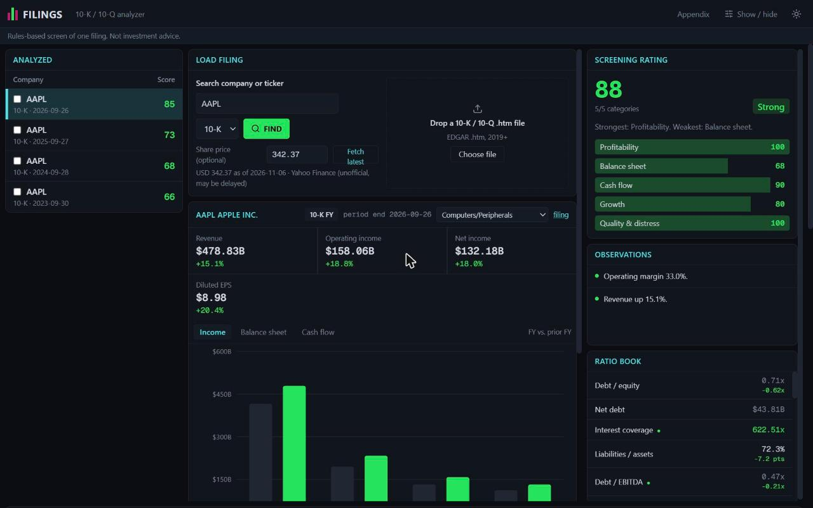

# Filing Analyzer

Look up a public US company, or drop in its annual or quarterly report, and get the key financial ratios, quality scores and a simple rule-based rating, with the formula and source behind every number.



> **Not investment advice.** The rating is a rules-based screen of one filing. It does not tell you to buy, sell or hold anything, and it ignores price trends, news and management.

## What it does

- **Finds filings for you.** Type a company name or ticker, pick a 10-K (annual report) or 10-Q (quarterly report), and it loads the filing from the SEC. Or drop in a downloaded filing file.
- **Calculates the ratios.** Margins, liquidity, debt, efficiency, growth and cash flow. Click any ratio to see its formula and the exact figures it used.
- **Scores financial health.** Piotroski F-score and Altman Z-score, plus a 0 to 100 screening rating with the rubric shown in full.
- **Compares to the market.** Industry averages (Damodaran) and market ratios such as P/E and EV/EBITDA (Finnhub).
- **Compares periods and companies.** Check two filings side by side, chart a ratio over five years, and export the ratios as a CSV.

Green always means favorable and red unfavorable. Lower debt and a lower P/E count as favorable, so red is not simply "went down".

## Run it on your computer

You need [Node.js](https://nodejs.org) 20.9 or newer (which includes npm) and [Git](https://git-scm.com).

```bash
git clone https://github.com/benjaminsinger18-arch/filing-analyzer.git
cd filing-analyzer
npm install
```

Create your settings file, then open `.env.local` in any text editor:

```bash
cp .env.example .env.local        # Mac / Linux
copy .env.example .env.local      # Windows (Command Prompt)
```

Set `SEC_USER_AGENT` to your name and email, like `Jane Doe jane@example.com`. The SEC asks every program that downloads filings to say who is asking, and it blocks requests that don't. Leave the other two lines empty for now.

```bash
npm run dev
```

Open <http://localhost:3000>. Click one of the example tickers to try it.

Uploading a downloaded filing works without any settings. Searching by company name or ticker needs `SEC_USER_AGENT`.

## Settings

Everything lives in `.env.local`. Restart `npm run dev` after changing it.

| Setting | What it turns on | Where to get it | If left empty |
| --- | --- | --- | --- |
| `SEC_USER_AGENT` | Searching companies and loading filings from the SEC | Your own name and email, no signup | Search fails. Uploads still work. |
| `FINNHUB_API_KEY` | Market ratios, and fills ratios a filing can't provide | Free key at [finnhub.io](https://finnhub.io) | Those ratios stay hidden. |
| `ALPHAVANTAGE_API_KEY` | Share price from Alpha Vantage (free tier: 25 requests a day) | Free key at [alphavantage.co](https://www.alphavantage.co/support/#api-key) | Price comes from Yahoo Finance instead. |

Keep `.env.local` private. It is already excluded from Git.

## Using the app

1. **Load a filing.** Search for a company, choose 10-K or 10-Q, then click a filing in the list. Or drop in a filing file (the main `.htm` file from EDGAR, 2019 or later).
2. **Read the results.** The rating and observations are on the right, the ratio book below them, and a chart of the main statements in the middle. Small numbers under each ratio show the change from a year earlier, and a dot marks how it compares with its industry.
3. **Open the appendix** (link at the top) for every ratio with its formula, the industry and market comparison tables, the full rating rubric and the filing details.
4. **Compare.** Tick two filings in the Analyzed list to see them side by side.
5. **See trends.** Click "Load last 5 for trends" under a list of 10-Ks, then pick a ratio in the Trend panel.
6. **Share.** The address bar always holds a link to the current filing. Copy it to send someone the same view.
7. **Show / hide** (top right) controls which ratio groups appear. Light and dark themes are one click away.

Filings you've analyzed are remembered in your browser between visits.

## Where the data comes from

- **Filings:** [SEC EDGAR](https://www.sec.gov/edgar). Numbers are read from the structured data (inline XBRL) inside each filing.
- **Industry averages:** [Aswath Damodaran's US industry datasets](https://pages.stern.nyu.edu/~adamodar/New_Home_Page/data.html) (NYU Stern, January 2026).
- **Market ratios and gap filling:** [Finnhub](https://finnhub.io).
- **Share price:** Alpha Vantage, or Yahoo Finance's unofficial endpoint as a backup.

## Good to know

- Works with US filings from about 2019 onward. No PDFs or older filings.
- A blank means the number isn't available. Missing values are hidden rather than shown as zero.
- Some blanks are real. Apple doesn't report interest expense, and banks have no gross margin.
- Banks and insurers are reported differently, so they get a Banking section instead of some standard ratios, and Altman Z-score is unreliable for them.
- When a filing can't produce a ratio, the app uses Finnhub's trailing-twelve-month figure and labels it "Finnhub, TTM" in the appendix. A number computed from the filing is never replaced.
- Industry figures are group averages, not medians, and use Damodaran's definitions.
- The share price usually comes from a different date than the filing period.
- A company that moved to a new registration number (ExxonMobil Holdings is one) may have no filings under the new one. Upload its predecessor's filing instead.

## Troubleshooting

- **"Lookup failed" or no filings found:** check that `SEC_USER_AGENT` is set in `.env.local` with a real name and email, then restart `npm run dev`.
- **No price or market ratios:** add the optional keys above. Yahoo Finance covers the price without one.
- **The app looks out of date after `git pull`:** stop the server, run `npm install`, and start `npm run dev` again.
- **Port 3000 is already in use:** run `npm run dev -- -p 3100` and open that port instead.
- **Node version error on install:** update Node to 20.9 or newer (`node -v` shows your version).

## For developers

Built with Next.js 16, React 19, Tailwind, Recharts and KaTeX. Filing parsing uses htmlparser2 and runs in the browser, so uploaded files never leave your machine.

```bash
npm test             # unit tests (Vitest)
npm run lint
npm run build        # production build
npm start            # serve the production build
npm run bench:build  # refresh industry data from Damodaran's spreadsheets
```

```text
src/lib/ixbrl/    read the filing's tagged numbers and map them to standard line items
src/modules/      one file per analysis: profitability, liquidity, leverage, and so on
src/components/   the page (analyzer.tsx holds the state; other files are panels and tables)
src/app/api/      server routes for SEC lookup, search, market data and industry averages
src/data/         industry averages and the ticker-to-industry map
```

**Add an analysis.** Create a file in `src/modules/` that exports an `AnalysisModule` (an `id`, a `title` and a `run(fin)` that returns metrics), then add it to `src/modules/registry.ts`. Every metric lists its inputs, so the formula trace and tests come for free.

| Module | What it computes |
| --- | --- |
| Profitability | gross, operating, net and EBITDA margin, ROA, ROE, equity multiplier |
| Liquidity | current, quick and cash ratio, working capital |
| Leverage | debt/equity, net debt, interest coverage, liabilities/assets, debt/EBITDA |
| Efficiency | asset turnover, DSO, DIO, DPO, cash conversion cycle |
| Growth | year-over-year revenue, operating income, net income, EPS |
| Cash flow | OCF/net income, free cash flow, FCF margin, accruals ratio |
| Banking | net interest income and margin, efficiency ratio, provisions, loans/deposits, equity/assets |
| Quality | Piotroski F-score, Altman Z''-score |
| Industry | company vs. Damodaran industry averages, flagged Above, At or Below (within 5%) |
| Market | Finnhub P/E, PEG, EV/EBITDA, EV/revenue, P/B, beta, dividend yield |
| Valuation | P/E, P/B, market cap, EV/EBITDA, FCF yield from a share price |
| Rating | weighted composite from the rubric in `src/modules/rating.ts` |
| Observations | plain-language flags such as an operating loss or thin interest coverage |

## License

MIT. See [LICENSE](LICENSE).

## Credits

Filing data from the US Securities and Exchange Commission. Industry data by Aswath Damodaran. Market data from Finnhub, Alpha Vantage and Yahoo Finance.
