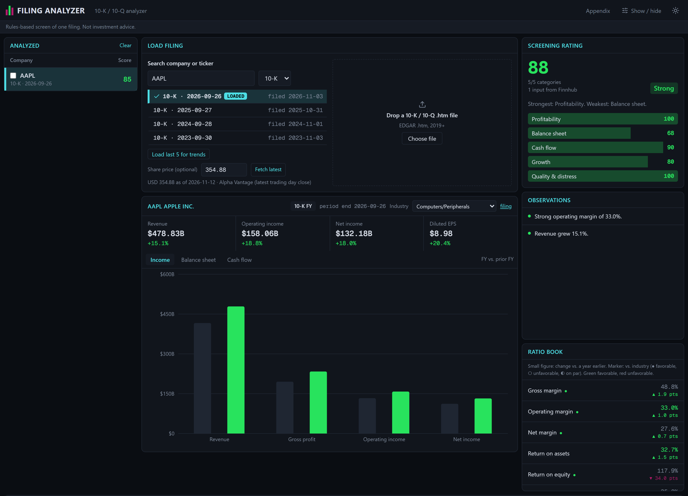
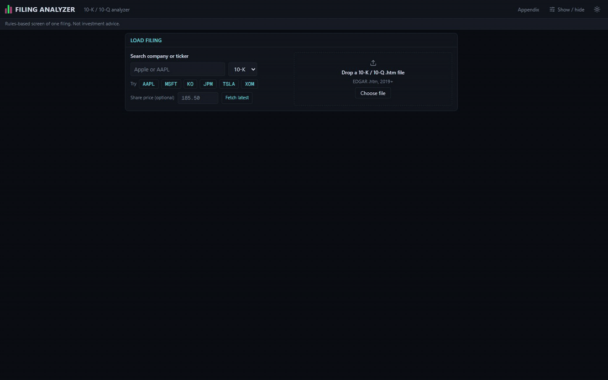
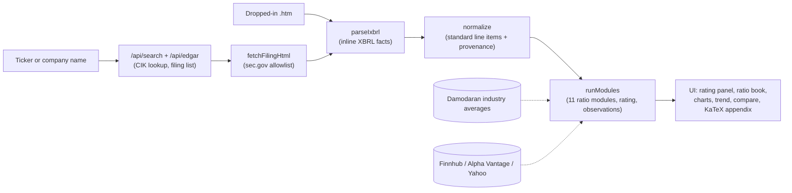
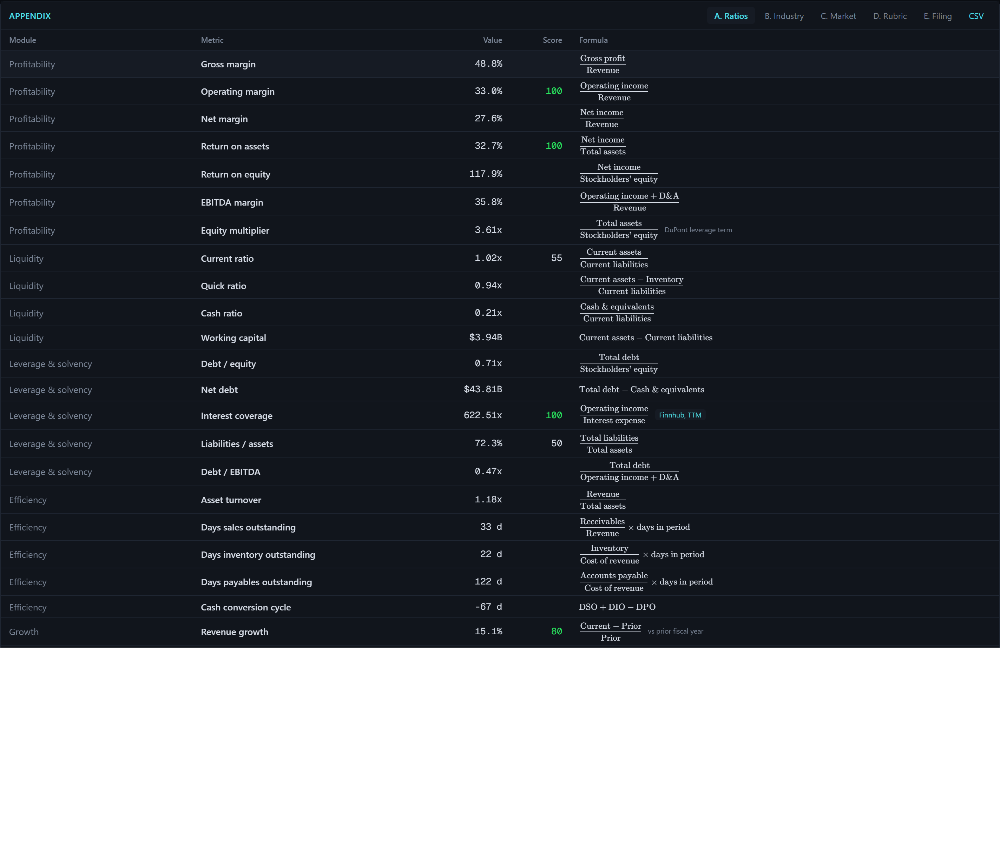
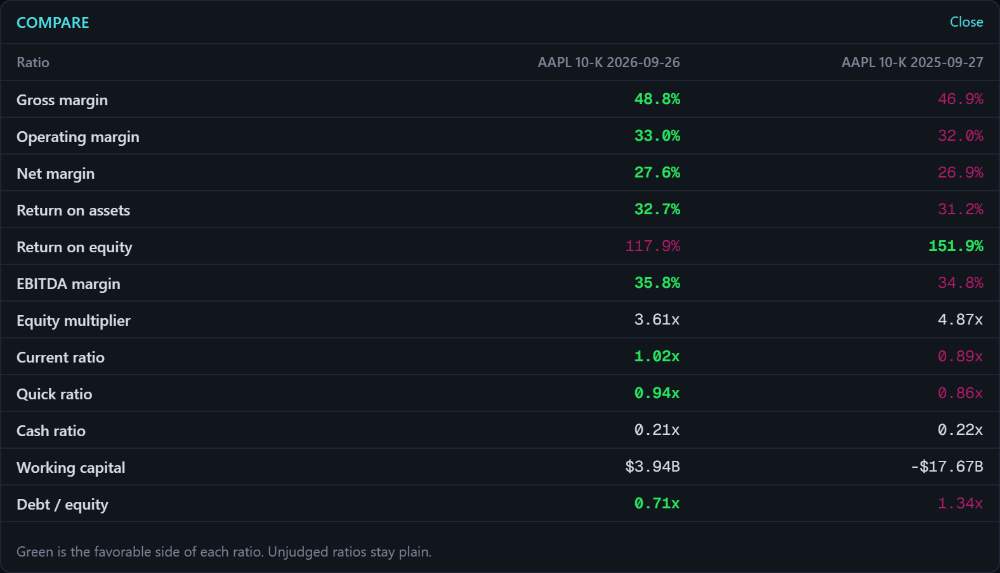
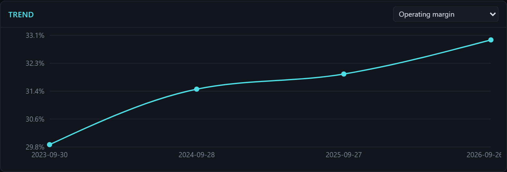

# Filing Analyzer

**Drop in any SEC 10-K or 10-Q and get every key ratio, a Piotroski / Altman health check and a transparent 0-100 rating, with the formula and source behind every number.**

[](https://github.com/benjaminsinger18-arch/filing-analyzer/actions/workflows/ci.yml)
[](LICENSE)




<details>
<summary>Watch a 12-second demo: search, load a 10-K, read the rating</summary>



</details>

> **Not investment advice.** The rating is a rules-based screen of one filing. It does not tell you to buy, sell or hold anything, and it ignores price trends, news and management.

## What it does

- **Finds filings for you.** Type a company name or ticker, pick a 10-K (annual) or 10-Q (quarterly), and it loads the filing straight from the SEC. Or drop in a downloaded filing file.
- **Calculates the ratios.** Margins, liquidity, debt, efficiency, growth and cash flow. Click any ratio to see its formula with the exact figures it used.
- **Scores financial health.** Piotroski F-score and Altman Z-score, plus a 0 to 100 screening rating with the rubric shown in full.
- **Compares to the market.** Industry averages (Damodaran) and market ratios such as P/E and EV/EBITDA (Finnhub).
- **Compares periods and companies.** Two filings side by side, a five-year trend chart for any ratio, and CSV export.
- **Shares a view with one link.** The URL always holds the current filing and settings.

## How it works



A filing's numbers are read from the inline XBRL tags inside the HTML, mapped to standard line items with the source tag recorded, then handed to eleven small pure modules. Each metric declares its inputs, so the appendix can print the formula with real figures substituted and tests can pin every mapping. Parsing runs in the browser, so an uploaded filing never leaves your machine.

## Tech stack

| Layer | Choice | Why |
| --- | --- | --- |
| Framework | Next.js 16, React 19 | API routes for the SEC and market lookups live next to the page; static where possible |
| Language | TypeScript, strict, zero `any` | Financial math should not have loose types |
| Parsing | htmlparser2 | Streams a multi-megabyte filing in the browser without a DOM round-trip |
| Charts | Recharts | Statement chart, trend lines and comparison bars from one dataset shape |
| Formulas | KaTeX | The appendix renders each ratio as real notation with the inputs filled in |
| Styling | Tailwind CSS v4 | Dark and light themes from one token set |
| Tests | Vitest, 65 tests | Parser, normalizer and every module run against fixture filings in CI |

## Quickstart

```bash
git clone https://github.com/benjaminsinger18-arch/filing-analyzer.git
cd filing-analyzer
npm install
cp .env.example .env.local   # then set SEC_USER_AGENT to "Your Name you@example.com"
npm run dev                  # http://localhost:3000
```

The SEC requires a name and email on every request, so `SEC_USER_AGENT` is the one required setting. Uploading a downloaded filing works with no settings at all. Optional Finnhub and Alpha Vantage keys, deployment notes and troubleshooting are in [docs/SETUP.md](docs/SETUP.md).

## Screenshots

<details>
<summary>Appendix: every ratio with its formula and inputs</summary>



</details>

<details>
<summary>Compare two filings side by side</summary>



</details>

<details>
<summary>Five-year trend for any ratio</summary>



</details>

## Engineering highlights

- **Provenance on every number.** Each metric carries the tags, figures and formula that produced it. The appendix shows the math; the UI labels anything filled from a provider ("Finnhub, TTM") and never overwrites a figure computed from the filing.
- **Eleven pure modules with a declared contract.** Profitability, liquidity, leverage, efficiency, growth, cash flow, banking, quality scores, valuation, industry and market each expose `run(fin, results)`. Adding an analysis is one file plus one registry line.
- **Banks are handled, not faked.** Financial institutions get net interest margin, efficiency ratio, provisions and loans/deposits instead of ratios that do not apply to them.
- **10-Q annualization.** Flow-over-balance ratios on a quarterly filing are scaled to a year and flagged, so a 10-Q and a 10-K read on the same scale.
- **In-browser iXBRL parsing.** Dropped-in filings are parsed client-side; the server only proxies allowlisted `sec.gov` URLs.
- **URL as state.** Ticker, form, filing, tabs and compare selection live in the address bar, so any view is a shareable link.
- **Strict TypeScript and 65 tests** over the parser, normalizer, gap-fill, prior-period and benchmark logic, run on every push by GitHub Actions.

## Roadmap

- Live demo on Vercel.
- 20-F and 40-F support for foreign filers.
- Peer selection: compare against a hand-picked set of tickers instead of the Damodaran industry average.
- Segment breakdowns where a filing tags them.
- Export the appendix as a PDF.

## Docs

- [Setup](docs/SETUP.md): run it locally, settings, deployment, troubleshooting
- [Using the app](docs/USING.md): walkthrough, how to read the colors, data sources and caveats
- [Developing](docs/DEVELOPING.md): scripts, folder map, pipeline, adding a module, tests

## License

MIT, Benjamin Singer. See [LICENSE](LICENSE).

Filing data from the US Securities and Exchange Commission. Industry data by Aswath Damodaran (NYU Stern). Market data from Finnhub, Alpha Vantage and Yahoo Finance.
